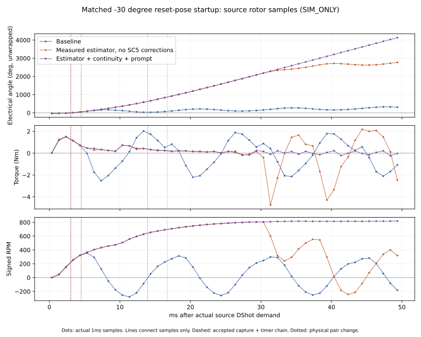

# E62 execution v5 — first-sector control and SC5 continuity

This phase implements two isolated, SIM_ONLY firmware corrections for source-observed SC5 integration defects, plus passive acquisition/first-sector diagnostics and controlled controller experiments. It does not qualify Original Rel17.3, physical hardware, or Flying Restart. All failed experiments remain evidence. Existing Draft PRs remain unmerged; no issue is closed.

## Causal reconstruction

The calibrated baseline below is experimental ELF `e198f5e9…`, not Original `05563b69…` or Production Root Fixes `c49a7485…`. Source DShot first demand is **1500000100 ns**. The unchanged first-capture policy rejects 2782 us against 5000 us, then accepts 13728 us and requests 2733 us. Firmware diagnostic ticks are not substituted for source virtual timestamps.

| Source event | Absolute virtual ns | Observation |
|---|---:|---|
| First physical drive pair | 1500301720 | C_H/B_L, mask24, floating A; gate enabled |
| First CAP1 | 1503001732 | Real selected-A transition, read/ACK, Guest rejects2782us |
| First sampled negative torque | 1505351964 | +354.720rpm, angle1.584rad, currents[0,−25.310,+25.310]A, torque−0.020423Nm |
| First sampled significant reverse speed | 1509351964 | −176.236rpm, angle2.600rad, currents[0,−24.699,+24.699]A, torque−1.373823Nm; still initial pair, before accepted feedback |
| Second CAP1 | 1513948204 | Guest accepts13728us; read/ACK and actual T12 programming agree |
| T12 start | 1513949512 | Native100MHz LOAD273299, programmed2733000ns |
| First T12 IRQ | 1516682512 | Exactly2733000ns after start; no replacement before IRQ |
| Physical next pair | 1516720196 | A_H/B_L mask9, floating C; IRQ-to-pad latency37684ns |

ROTOR samples have1ms resolution. At first CAP1 the prior sample is649768ns old and the next is350232ns later. These bracketed states are not interpolated instantaneous measurements. PWM_PAIR includes source-sampled sector-change angle; instantaneous pads come only from the explicitly bounded SWITCH_FOCUS window. At CAP1 the observed pads are B_L/C_L mask40 (PWM recirculation), not a continuously energized mask24. The analyzer retains absolute time, pad-state age, rotor sample age and incomplete windows.

In the first50ms there are **6 negative-torque samples before accepted feedback**, none in the sampled accepted-capture-to-first-pair-change interval, and **17 after the physical pair change**. These counts do not measure continuous negative-torque duration or impulse. Small negative PWM ripple is not by itself loss of synchronization; significant rotor reversal is checked independently. The pre-feedback reversal cannot be caused by a commutation IRQ that has not occurred.

The90° reset control demonstrates a separate open-loop alignment problem: at demand the actual sampled rotor is **4.506rpm /10.361rad (593.642° unwrapped)**, not a stationary90° rotor. Pre-demand audio switching is source-supported lifecycle inference; no direct Guest audio-owner observation is claimed. Initial-sector torque is already negative before accepted feedback. Model angle is used only for offline diagnosis, never as Guest input. Idle/neutral/coast does not prove standstill.

## Controlled controller experiments — failures retained

All use unchanged QEMU motor constants/solver, exact CFG/scenario/source plans, identified source-built ELF, and original P1 thresholds. They are controller candidates, not edits to the acceptance criteria. Production/default compilation retains the original policy.

| Hypothesis / isolated candidate | Native outcome |
|---|---|
| H1 accept the early first crossing with quarter window only at sync0 | First capture accepted; requested2049us; next pair at+5.134548ms, source angle1.415rad (~81.1°), already beyond the next C spatial zero (~60°). Initial-sector negative samples disappear, but59 significant reversals remain. FAILED. |
| H2 seed initial interval from twice the newly accepted real capture | Requested1391us; next pair+4.467748ms, source angle0.912rad (~52.3°). Next genuine1651us crossing rejected by unchanged subsequent half-window2782us.59 reversals. FAILED. |
| H6 quarter window through sync5, then restore original locked policy | Six crossings accepted; seventh1003us rejected against filtered half1106us.60 reversals. FAILED. |
| H8 use measured acquisition intervals through sync5, then original locked filter/window |35 real captures accepted before the SC5 blind window described below.56 reversals at−30°,58 at90°. FAILED; capture count alone is not rotor synchronization. |

Actual-Core regressions exercise default policy and each candidate under UBSan, including early/negative/overflow intervals, safe stop before timer start, timeout/restart and restoration of locked behavior. These are isolated experimental branches, not production fixes.

## SC5 defects and minimal corrections

**H9 — equivalent-reference refresh masks a real crossing.** With the measured-acquisition candidate, the source observer records selected B/falling at **1529482876ns**, theta36.6531932115rad (2100.073°), omega84.4680325852rad/s. The actual motor sample is104ns old. Native ECAP route is correct (ECCTL0=45), counter runs (ECCTL2=144), but ECCTL1=1 has CAPLDEN off and ECEINT=0. No native CAP1 follows that transition. PWM counter3294/period3778 is observed; this profile has no SW_BLANKING. Equivalent2047-code refresh stops capture while changing only sample association. A later capture arrives6.705ms later; reversal follows. This is a source/register-backed integration defect, not proof that motor physics or timer dispatch is wrong. The instantaneous observer torque−0.1085Nm is PWM ripple and is not independently used to declare reversal.

Isolated branch `fix/e62-equivalent-reference-continuity` leaves capture on while the **old published reference remains fresh and coherent**, stages the new same-code identity, and commits it **only at native ZERO**. It does not ACK a pending capture, reset its epoch, rearm an accepted capture, or replace T12. Phase/abort cancels pending association. Active-DAC, route, polarity, epoch, latest validity and freshness are rechecked at actual capture use. Changed-code publication retains capture quarantine and two-ZERO fixture settling.16 new register race/negative cases and the complete107-group SDK suite pass, with feature-on and feature-off results preserved.

**H10 — producer latency consumes the freshness margin.** H9 alone initially produces zero reversals by **safely halting**, not by running successfully. At tick23889, old sample1491 acquired at23856 has age33; latest1492 is valid. The old producer converts the completed ADC sample only at the following1kHz request. The subsequent ZERO may therefore exceed unchanged age32. The resulting insufficient-commutation P1 failure is retained.

Isolated branch `fix/e62-sc5-prompt-producer` factors the same calibration calculation into a service called before the unchanged Core worker by the existing16kHz PendSV path. No additional interrupt or ADC trigger is introduced; ADC request cadence stays1kHz, acquisition/completion ticks are unchanged, and calibration arithmetic stays outside the ADC ISR. It does not relax age32 or publish association before ZERO. Tests cover partial/full raw epochs, identity/timestamp preservation, no extra trigger, invalid data, stale data and blackout; actual-port dispatch tests cover feature-off/on. Complete107-group SDK suites pass with the feature off, on, and with H9+H10 combined.

Both corrections remain SIM_ONLY opt-in experiments. New ARM builds pin firmware/SDK/compiler hashes, explicit AM13E target and4KiB ELF page alignment. Initial failed all-target builds and CFG-overlapping64KiB ELF variants are retained, excluded from motor conclusions, and rejected by the new preflight.

## Native results and independent restart

See `e62-engineering-evidence-v5.json` and the archived per-case matrix for complete outcomes, including failures. The combined H8+H9+H10 ELF is **774019cdb4cd079a7f518d38b243640adef79c8ebfb6c97364ecf98cb6af4c6f**. This is a newly labeled experimental identity. The source observer variant is read-only; no plant integration is advanced for observation.

The−30° short startup completes592 actual CAP1 ACKs /592 closed-loop PWM pairs with zero significant direction changes. In the1.5s first-demand restart control it completes2595 CAP1 ACKs with1498 positive samples above50rpm and no samples below−50rpm. This is sustained native progress, not a stopped-rotor false positive. Original-Guest qualification still fails identity;90° startup still fails motor synchronization. Combined corrections are not a single-variable controller experiment; isolated source/register regressions establish the individual defects.

After300ms coast, the stable first-demand control reaches the second source demand with **+6.634rpm**, angle263.182° wrapped; standstill is unverified. The new CAP1 ACK begins+11.548916ms later. Restart has555 samples below−50rpm and fails independent reacquisition criteria. Successful first startup therefore does not establish Flying Restart. Remaining coast-duration, fault and dynamic-input outcomes are recorded in the machine-readable case matrix without changing their verdicts.

## Reproduction and evidence

Activate the restored toolchain with `source /workspace/setup-escape32/activate.sh`. No installation script was rerun and this resumed instance is not claimed as a genuinely new-task restore. Build examples and exact per-case argv/source-input hashes are in each `*.build-provenance.json` and `*.command.json`.

```sh
python -m tools.e62_build_campaign_firmware --help
python -m tools.e62_acquisition_candidate_campaign --help
python -m tools.e62_first_sector_chronology --events CASE.p0.events.log --evidence CASE.json --focus-ms 1499:1545 --policy estimator --output CASE.chronology.json
python -m tools.e62_bemf_acquisition_audit --log CASE.qemu.log --output CASE.acquisition.json
python -m tools.e62_vbus_handover_audit --log CASE.qemu.log --evidence CASE.json --output CASE.reference.json
python -m unittest tests.test_e62_first_sector_chronology tests.test_e62_bemf_acquisition_audit tests.test_e62_vbus_handover_audit tests.test_e62_reference_bulk tests.test_e62_issue5_bemf_diag tests.test_e62_second_demand_oracle tests.test_e62_passive_trace_schema tests.test_e62_issue5_cap1_timer_audit
AM13E_SDK_ROOT=/tmp/e62-issues/sdk bash mcu/_support/AM13E/tools/run_sc5_combined_pipeline_regression.sh
```

The final command runs in the firmware integration test branch. Focus window must match the recorded command; restart windows differ. Replays do not supply missing Guest history beyond the bounded first64 entries. Later-demand acceptance is inferred from actual CAP1 read/ACK/T12 programming, labeled explicitly. Source timestamp/counter correspondence uses local ZERO pairs, not host time or an assumed global affine mapping.

Original ELF05563b69… remains untouched; c49a7485… remains historical Production Root Fixes evidence only; exact5b90b200… Issue3 results are retained without substitution/rerun. QEMU native-input6f99975e… and acquisition-observer386fc12d… are separate pinned executables. Baseline executabled5f4f510… is restored at the original build path. The virtual affine SC5 network is not measured board calibration or physical settling evidence.

## Outstanding acceptance gates

Criterion-level statuses are authoritative in `e62-engineering-evidence-v5.json`. Issue5 remains FAILED overall:90° startup, arbitrary actual rotor alignment, Flying Restart and full independent qualification remain software work. Native timing failures344–532ns remain FAILED with unchanged100ns gate; no new timing campaign or claimed fix is based on the47 non-reproducing trials. Issue3 exact14-case failures remain. Historical WSL full provenance, physical analog/model/board measurements and genuinely fresh-task verification remain explicitly blocked. Hardware is not the only remaining blocker.

| Acceptance criterion | Status | Scope |
|---|---|---|
| #10 Source chronology / actual sampled boundary state | DONE | Bounded and explicitly incomplete where appropriate |
| #10 Saved344–532ns violations under100ns gate | FAILED | No new discriminating recurrence; failures preserved |
| #4 Fresh-invalid native isolation | DONE | Original1kHz cadence, age18/32, invalid latest sample, no later CAP1 |
| #4 Comprehensive native route/epoch/delay combinations | IN_PROGRESS | Register coverage is separate |
| #4 Physical network calibration / settling | BLOCKED_EXTERNAL | Virtual affine network/two-ZERO fixture do not qualify silicon |
| #5 First-sector RCA / isolated SC5 corrections | DONE | Source/register evidence plus regressions; opt-in candidates |
| #5 Experimental stationary−30° first startup | DONE | Sustained native commutation; Original qualification still false |
| #5 General first startup /90° / fixed16 stress | FAILED | Reversals retained |
| #5 Independent Flying Restart300/1500/3000ms | FAILED | Stable first demand, residual motion at restart, second-demand failures |
| #3 Exact14-case qualification | FAILED | Prior exact5b90 evidence retained, no rerun/substitution |
| #6 Numerical software / physical correlation | DONE / BLOCKED_EXTERNAL | Existing numerical results; measured parameter/load/transient data missing |
| #8 Executed software gates / image-update guarantees / hardware approval | DONE / IN_PROGRESS / BLOCKED_EXTERNAL | Existing gates retained; atomic integrity/rollback and hardware remain open |

Native changing-input and safety results are distinct: the combined candidate completes the two planned VBUS handovers without significant reversals in that short scenario; native invalid-only has age18/32, missing-EOC fails at age33. Neither establishes analog settling. Fixed16 stress fails with56 reversals; switch16 retains zero significant reversals in the tested window. The source observer sees no matching disabled capture point in its bounded corrected run, versus one in the failing estimator control; the combined firmware trajectory differs, so this observation alone does not isolate H9 from H10.

Restart source policy is separately traceable: `src/main.c::laststep()` saves `oldstep`, neutral clears `step/sync/fast`, and the later start restores `step=oldstep`, resets interval to10000us and calls `nextstep()`. No coast rotor-angle feedback updates that saved sector. This explains why restart must be diagnosed from its own actual initial pair and pose:

| Coast | Actual first powered pair | Sampled RPM / wrapped angle before demand | First accepted CAP1 after demand | Negative torque samples before accepted / after first physical change (first50ms) | First sampled significant reverse |
|---|---|---|---:|---:|---:|
|300ms |B_H/C_L, mask36, floating A |+6.634 /263.182° |11.547948ms |5 /18 |+21.351708ms, after commutation |
|1500ms |B_H/A_L, mask6, floating C |+2.394 /172.633° |4.921460ms |0 /22 |+11.356220ms, after commutation |
|3000ms |B_H/A_L, mask6, floating C |+0.726 /37.920° |6.997508ms |4 /20 |+2.356268ms, before accepted feedback |

For3000ms, the first sampled currents are[−0.319,+0.319,0]A and torque−0.019189Nm; by+2.356268ms they are[−22.997,+22.997,0]A with torque−1.203754Nm and speed−149.078rpm. For1500ms the initial sector has no sampled negative torque, but after commutation torque becomes−0.300238Nm at+7.356220ms and speed reaches−73.132rpm at+11.356220ms. Thus restart contains both open-loop pose/sector failures and later synchronization failures; one generic “early capture” explanation is insufficient. Later-demand private Guest decisions are not saved beyond the first64 journal entries; accepted CAP1 here means the source-observed read/ACK/timer chain, explicitly an inference about acceptance. Small ACK latencies differ from CAP1 timestamps in this table.

The physical model's sinusoidal phase BEMF, terminal-equivalent Kt, inertia/no-load and virtual analog network remain unmeasured physical assumptions. They limit hardware conclusions, but do not erase the observed native register blind window or retained-sector source policy. No motor parameter was changed to improve these runs. A fixed replacement sector or an alignment pulse without independent acquisition/current/protection validation is not presented as a qualified Flying Restart fix.

A further **single-factor native control** retains H8 estimator and H10 prompt producer but disables H9 continuity: ELF `41bb3aec893fa0508fab6e652c78e22b493d8916016986bcab2ea98ec3f39077`. Same source inputs/QEMU builds give46 significant reversals/166 CAP ACKs without the acquisition observer and45 reversals/178 ACKs with its first-window observer. Corrected controls have zero reversals/592–593 ACKs. This supports the continuity correction independently of the producer change; it does not make capture counts the acceptance gate.

A separate bounded70–120ms observer run was chosen around the independently observed93–100ms control failure. It has22 reversals, with the first significant reversal now at229.349ms, outside that window. The corrected matched late-window run has0 reversals/592 ACKs. Neither late-window trace contains a matching disabled point; the missing late capture is therefore **unobserved**, not reconstructed. Instrumentation/run-to-run trajectory sensitivity remains a limit. The original explicit1529482876ns disabled transition and all these failures remain intact. No further source-clock fix claim or repeated timing campaign follows from these runs.

Review branches were pushed successfully. `gh pr create --draft` first failed sandbox proxy socket access; the outer retry returned **`Post "https://api.github.com/graphql": Forbidden`**. New Draft creation remains API-blocked; comparison links and complete bodies are in `docs/review/pr-inventory-v1.json`. Existing user-confirmed Drafts QEMU13/14/15 and Firmware10 are recorded as Draft/unmerged. Firmware default is `am13e-port-v2`; experiments stack on Firmware10 rather than `main`.

The baseline's second accepted A/rising transition is also diagnostically different from a forward spatial zero: its1ms rotor bracket changes speed from−87.785 to+54.886rpm while phase-A sine stays positive (.568→.541), at angles34.607→32.773°. The analyzer labels `RPM_SIGN_CHANGE_WITH_STABLE_PHASE_SINE`. This is consistent with motion-induced BEMF sign change during oscillation, rather than a valid forward sector crossing; it is a sampled model inference, not a fabricated direction sensor or a direct instantaneous Guest observation. The late accepted capture can therefore schedule a real timer without restoring correct six-step spatial alignment.



The calibrated baseline here is experimental, not the Original ELF. The figure connects actual1ms samples for readability and retains sampled negative PWM ripple in the stable trace. The reference corrections alone, with the original half-capture policy, still produce59 reversals (`2a6e8bb0…`); prompt producer alone also produces59 (`d74a5081…`). Controller-policy and reference-path defects therefore remain separate review units.
