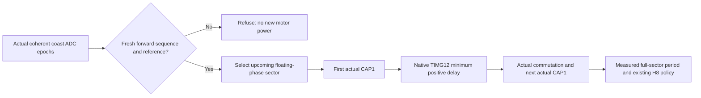

# Issue5 incremental execution v6 — 2026-11-08 Asia/Taipei

The H13 SIM_ONLY coast-acquisition candidate passes the independent second-demand rotor/control gates for the three requested300/1500/3000ms coast scenarios in the recorded runs. The earlier H12 delay-estimation candidate safely refused all three and did not resolve Flying Restart. These are separate experimental identities. Original Guest qualification remains false; no P1 gate, motor constant, model equation, production firmware, merge or issue disposition changed.

## What was recovered and reused

The new published instance initialized successfully. Both repositories and remote branch identities were verified without resetting or overwriting existing work: QEMU diagnostic baseline `c464c6ee02be4f0c879f6dff51f9f989fb566749`, engineering report `bf6e60ae0e0ba8b245743578f8949af868a57025`, firmware integration `afe321a42aeebb6c8d449f8c9be34fb7f561a4df`; firmware default remains `am13e-port-v2` (`53953c04f7d857f3b402b3a19870605ed0471d8f`). The canceled previous environment is an environment failure, not a firmware or simulator test verdict.

Verified executable SHA256 `6f99975e319ada16af98050c66b1ee39fef690d8dca16ec08a6c59560f7faef8` and v5 ELF `774019cdb4cd079a7f518d38b243640adef79c8ebfb6c97364ecf98cb6af4c6f` were restored exactly, along with raw restart traces. QEMU upstream submodule remains `44f28df24767cf9dca1ddc9b23157737c4cbb645`. No installer, T01, repository-wide62-test audit or full Issue3 matrix was rerun. Existing passes are reused only for their recorded identities or unchanged component dependencies, never silently transferred to a new ELF. The former v5 first-start result is not a restart verdict.

Original05563b69…, Production Root Fixes c49a7485… and experimental firmware remain distinct. The production-root ELF was not substituted. Earlier344–532ns timing failures retain their original100ns gate and FAIL status; this work does not claim to fix them.

## RCA: duration is not rotor phase

The v5 source evidence is reused, not recreated. At the second DShot demand:

| Coast | Actual sampled RPM / wrapped electrical angle | First powered pair | Retained oldstep | Earliest failure in that v5 run |
|---|---|---|---|---|
|300ms |+6.634 /263.182° |B_H/C_L, floating A |3, inferred from source sequence and actual pair |Negative torque before accepted feedback; first significant reverse after commutation |
|1500ms |+2.394 /172.633° |B_H/A_L, floating C |4, inferred |Initial sector accelerates forward; first accepted capture followed by late commutation and reverse rotation |
|3000ms |+0.726 /37.920° |B_H/A_L, floating C |4, inferred |Negative first-sector torque and reverse speed before accepted feedback |

The original source stop saves `oldstep`; restart restores it, initializes the interval to10000us and advances to the next sector. Coasting provides no update to that saved sector. A sector that was appropriate before neutral is therefore not a current phase estimate. New passive records directly retain Guest oldstep and selected step; the older private values above remain explicitly inferred, not retroactively fabricated.

For3000ms, v5 source samples show currents[−0.319,+0.319,0]A and torque−0.019189Nm at+0.356268ms, then−149.078rpm before accepted feedback. For1500ms, the first sector has no sampled negative torque; the first physical sector change arrives at+7.302056ms, source angle about347.7°, beyond the next B spatial crossing at300°. Negative torque and significant reverse speed follow. The first4.7ms capture is an accelerating partial sector; doubling it to9400us and delaying2350us does not estimate the upcoming sector correctly. For300ms the accepted transition occurs around a speed sign change; an acknowledged CAP1 is not proof of a forward spatial crossing.

These are source-observed events, Guest decisions and sampled model inferences in different categories. Rotor samples are1ms apart; boundary ages and brackets are retained. Negative torque samples are not a continuous torque impulse, and small PWM ripple is not itself loss of synchronization. Source virtual timestamps, never host elapsed time, define the chronology.

Configuration-matched new runs reach different actual poses and sometimes different oldstep values. One H12 shadow control even passes the1500ms independent rotor gate with the old policy. This does not erase the v5 failure: it confirms that favorable alignment can hide the defect. A/B inputs are pinned, but their motor states are measured rather than asserted identical. This report does not attribute every trajectory difference to one instruction or claim a scheduling RCA.

## Available Guest signals and the H12 counterexample

The actual coherent, Guest-read phase triples in the last20ms of the v5 coasts are constant:

| Coast | Actual phase-ADC codes | Spread | Instantaneous conclusion |
|---|---|---:|---|
|300ms |[2047,2048,2048] |1code |Tied extrema; no standalone direction proof |
|1500ms |[2048,2048,2047] |1code |Tied extrema; no standalone direction proof |
|3000ms |[2048,2047,2048] |1code |Tied extrema; no standalone direction proof |

This does not establish standstill. The offline observability tool requires matching actual EOC/read identities for all three phases, excludes future samples and reports missing epochs as incomplete. Its input contains no rotor angle/RPM.

H12 attempted to seed the first restart delay from fresh three-sample vector rotation once signal amplitude was sufficient. It required coherent sample progression, epoch/freshness, direction consistency and valid timing bounds. Integer CORDIC was independently checked across72quadrants/poses against a floating reference. All three gated native candidates returned period0 and safely stopped rather than reacquiring. Their recorded first-demand windows remain stable; their second-demand failures remain failures.

An initial implementation introduced a floating-point dependency into a target that did not enable FP access. A representative instrumented run proves CFSR`0x80000`(NOCP), HFSR`0x40000000`, CPACR0; disassembly shows a VFP prologue. Nine initial submitted cases faulted before motor drive and are preserved as candidate boot failures, not restart evidence. The set should have been screened with one case first. Subsequent testing used a single boot/coupling screen. Integer CORDIC removed the new dependency without enabling the CPU unit or modifying QEMU. The broad integer observer also perturbed the coast entry pose; it was subsequently restricted to pending restart. H12 remains an unsuccessful, separately reviewable experiment.

## H13: acquire the upcoming sector from coast history

H13 is an independent branch based on the published H8+H9+H10 integration. It preserves the H9 continuity and H10 prompt-producer branches as separate units. The new module consumes only coherent real phase-ADC epochs collected during coast and the acquired calibrated reference. It never receives QEMU angle/RPM/current/torque, writes no fabricated feedback and adds no ADC trigger or simulator physics.

The observer derives a phase sign pattern relative to the three-phase common mode, follows ordered adjacent patterns and requires at least two consistent forward transitions, a stable current pattern, fresh current samples, matching epochs and reference/sample identity. Missing/equal/invalid/rail data, a gap, contradictory sequence, stale evidence or reverse command causes refusal. The selected floating phase must also be on the pre-crossing side of the acquired reference for the expected actual comparator edge. Reverse operation is deliberately not authorized by this forward-only prototype.

The sequence selects the sector whose floating-phase crossing is upcoming, rather than the sector following oldstep. The old value is retained for diagnosis. Before any new motor enable, the Guest records the old sector, inferred phase pattern/direction, history length, sample identity and selected sector. The existing MCPWM/CMPSS publication, route, polarity and epoch checks still own actual acquisition.

After independently acquiring phase, the first genuine CAP1 programs the existing native TIMG12 with its minimum positive1us delay. This intentionally changes the experimental first-crossing control policy; it is not a change to the P1 acceptance criteria or the Original binary. No partial elapsed interval is presented as a measured full sector. The second actual crossing supplies the first measured full-sector interval, then the unchanged configured timing formula and H8 acquisition/locked policy resume. A timeout during this acquisition refuses safely. No synthetic capture, IRQ, rotor value or delay-derived fictitious measurement is inserted.

### Recorded candidate results

| Coast | Entry RPM / wrapped angle | oldstep → selected powered step | Guest coast transitions | First / second CAP interval | Independent second-demand result |
|---|---|---|---:|---|---|
|300ms |+5.208 /325.119° |5 →1(C_H/B_L) |2 |2988 /1658us |PASS_NEW |
|1500ms |+2.045 /50.994° |4 →2(A_H/B_L) |10 |1790 /2330us |PASS_NEW |
|3000ms |+1.027 /122.822° |4 →4(B_H/C_L) |24 |4068 /1477us |PASS_NEW |

Each second demand records1498 positive samples above50rpm spanning about1497ms of its1500ms window, zero significant reverse samples, and thousands of genuine CAP1 ACK/TIMG12 commutations. First20ms minimum signed torque is respectively+0.012407/+0.017069/+0.008551Nm. These are actual motor results, not an inference from capture count or safe refusal. Independent Original qualification remains false for the experimental ELF.

Candidate ELF: `f61c7e2cf240bf79a0cdc2d65c88c06c03a52865122a0054d7a14fba55b22e08`, source`20f169e`(full commit in build provenance), SDK`b872469ceef18de5e39a1d3acb0821ec158b44c7`, ARM14.2.1, explicit AM13E target and4KiB ELF alignment. Shadow control ELF: `ca0d40994efac4964d61073a690d10dc89f963af7180a77f6a6fea3401685e12`, source`d6ed5ff`; the source difference before the shadow macro is test-selector plumbing only. Subsequent disabled-module translation-unit guards do not change this pinned active executable; no native PASS is silently relabeled as a different ELF/HEAD.

## Scope and outstanding qualification

The ideal native ADC preserves phase sign information at a one-code span. H13 uses history, not a claimed instantaneous direction measurement from those tied values. This is meaningful source-owned SIM_ONLY evidence, but it is not a physical low-noise/offset qualification. The existing native ADC publishes BEMF codes even for powered phases; real terminal-voltage clamping, phase offsets, analog noise, settling and acquisition bandwidth require separate validation. Above-band motion can alias a sampled forward sequence; an independent bound or additional direction evidence remains required. Reverse-wind, near-zero ambiguity, comprehensive phase-specific fault combinations and full release regression remain open. No hardware approval follows from these runs.

The Source/P1 identity guard is preserved and continues to reject the experimental firmware. First startup at90° remains an unresolved v5 failure; H13 does not change cold-start policy. The initial H12 FP90° submission failed before motor drive and is not a valid H13 cold90° motor verdict. Its new−30° first-demand prerequisite is measured inside each new restart, not reused across ELF hashes. Offset/switch and sensor-fault results, shadow controls and exact per-case selection/commands are supplied in the accompanying v6 evidence matrix.

## Incremental selection and evidence

- `PASS_REUSED`: v5 passes only for the original recorded ELF/QEMU/CFG/scenario/acceptance identities; unchanged analysis components and prior source/model audits. No T01/62-host/full Issue3 rerun.
- `PASS_NEW`: new phase/epoch/sequence/edge/refusal/timeout tests, real signal replay and measured candidate second-demand gates. Actual-Core tests distinguish cold policy, acquired sector, first true capture and measured second period.
- `FAIL`: preserved v5 restart/90°/offset failures, H12 refusals, initial FP boot failures and failed compilation/preflight attempts. A successful build is not a motor verdict.
- `INCOMPLETE`: standalone physical direction proof, reverse/alias/noise coverage, unexercised native fault combinations and full critical/release qualification.
- `BLOCKED`: physical board/analog/model measurement gates and any demonstrated publishing/API restriction; software gaps are not relabeled as hardware-only blockers.

A wrapper initially ignored an inherited SC5-only selector and repeated unchanged register fixtures; those executions are preserved and are not represented as necessary new coverage. The selector was corrected. Later continuation runs only the impacted fixture. Compilation failures were corrected with an atomic calibrated-reference snapshot; neither a different firmware binary nor a different CFG was substituted to make a case run.

Exact configure/build and probe argv, source/ELF/executable/input hashes, concurrency, effective model values, raw P0 logs, private Guest records, strict/original and independent second-demand verdicts are in the evidence bundle. Source timestamps remain absolute. Later Guest acceptance is inferred from real read/ACK/T12 chains unless directly recorded. Diagnostic arrays remain bounded and missing evidence stays incomplete. All prepared PRs remain Draft/unmerged; no issue is closed.

### Shadow controls and negative cases

The three H13 shadow controls run the same observer but retain oldstep and the old H8 first-capture policy. All three fail independent reacquisition. Their actual entry poses are305.237°,180.311°,311.680°; the observer recommends steps1,5,1, while the old policy actually powers steps5,6,6. Thus the selected floating-phase crossing is already behind or inappropriate for the actual rotor sector. The source-derived first negative/reverse samples precede accepted feedback in these controls. The candidate/control entry states are not snapshot-identical; the per-run ADC recommendation, actual powered pads, rotor state and later control events are the causal evidence.

For the three successful candidates, the actual Guest-read histories contain161,1361,2890 consecutive coherent EOC epochs with the source gate off at the sampling instants. Replaying those samples yields exactly the Guest's2,10,24 forward phase transitions and its final patterns. This supports use of quiet-coast phase measurements rather than the native model's unphysical powered-phase ADC exposure. These are sampled gate observations, not a claim of continuously measured physical pad voltage or support for every brake/audio ownership configuration.

| New negative | Reacquisition | Safety observation |
|---|---|---|
|+16ADC-code mismatch |FAIL |First startup reverses; coast history indicates reverse; refused before second-demand power |
|−16ADC-code mismatch |FAIL |First startup reverses; reverse coast refused before power |
|Switching16-code artifact |FAIL |Current phase pattern has only one stable epoch; refused before power. The post-authorization transient path remains unexercised. |
|ADC1 completion clock lost1ms before second demand |FAIL(expected refusal) |PASS_NEW authorization guard: old phase sample age26 exceeds16, although reference valid1/age26 remains inside unchanged32; no powered pair or second-demand CAP1/TIMG12 |
|Invalid acquired reference1ms before second demand |FAIL(expected refusal) |PASS_NEW authorization guard: reference valid0 while retained last-good reference is still age26/32; phase history invalidated; no second-demand power or commutation |

All five finish with actual native gate mask0 and zero second-demand CAP1 ACK/PWM_PAIR/TIMG12 counts. These safe-refusal checks are PASS_NEW only for the negative authorization requirement. They are never reported as successful Flying Restart. Zero reversals alone would also be insufficient. The reference observations are passive stable SRAM snapshots taken at the same frozen Guest tick as refusal; their values are not synthesized from expected behavior. The reference ABI is checked against the target compiler and ELF symbol sizes.

## Exact commands and test selection

The build helper records full source commit, SDK pin, compiler version/hash, profile, target, page layout and complete configure/build commands in `*.build-provenance.json`. Each `*.command.json` records the exact probe invocation, ELF/executable/CFG/scenario/source-plan hashes, concurrency, harness hash and selection reason. A configuration-matched control differs in the declared shadow macro, not motor parameters.

```sh
source /workspace/setup-escape32/activate.sh
# Native candidate screen: only the previously failed3000ms case.
python -m tools.e62_restart_rate_campaign --diagnostic-kind coast --build-prefix coast-phase-v2 --output artifacts/e62-v6/coast-phase-screen --selection screen --screen-coast 3000 --jobs 1
# Remaining two failed coast durations, without repeating the completed screen.
python -m tools.e62_restart_rate_campaign --diagnostic-kind coast --build-prefix coast-phase-v2 --output artifacts/e62-v6/coast-phase-candidates --selection candidate-remaining --screen-coast 3000 --jobs 2
# Necessary shadow counterexamples after the candidate demonstrated real reacquisition.
python -m tools.e62_restart_rate_campaign --diagnostic-kind coast --build-prefix coast-phase-v2 --output artifacts/e62-v6/coast-phase-controls --selection controls --screen-coast 3000 --jobs 3
# Only new dependency-impacted safety/stress cases; not the Issue3 matrix.
python -m tools.e62_restart_rate_campaign --diagnostic-kind coast --build-prefix coast-phase-v2 --output artifacts/e62-v6/coast-phase-negatives --selection negative --negative-manifest artifacts/e62-v6/coast-negative-cases.json --jobs 3
```

Completed output directories intentionally reject overwrite. Reproduction must use a new output directory. Both new fault plans keep physical supply24V; only the declared source-owned acquisition fault mode changes at DShot frame3299. No CFG or QEMU binary is silently replaced.

New focused host tests exercise six phase sectors, forward/reverse sequence, no history, discontinuity, stale/epoch/reference polarity rejection, actual Core sector selection, real-capture timing, timeout and invalid/overflow capture stop-before-timer behavior. The existing45-analyzer suite and earlier full SDK passes are reused for their unchanged components/recorded identities. The active new SC5 bridge is compiled and exercised with the official SDK. Full new release/critical-path qualification is not claimed from these focused results.

An independent target ABI check verifies reference struct size28 and offsets8/12/24 for sample/acquisition/epoch. Active preprocessed module equivalence is documented for later non-executable typedef/test/documentation changes; motor results continue to identify the tested source20f169e and ELFf61c7e2c. The first screen's older display label `observed_direction` and later `guest_inferred_direction` describe the same retained Guest field; raw files are preserved and neither is treated as a direct physical direction sensor.



Remaining software gates include native phase/velocity sweeps, reverse-wind/alias discrimination, generic brake/audio eligibility, stable-phase availability at boundaries, post-authorization switching-artifact coverage, cold90° startup and full qualification of any final candidate. Physical noise/offset/bandwidth/settling and motor correlation also remain blocked on measurements. Hardware is not the only remaining blocker. Existing P1 identity and performance gates are preserved, all failed evidence remains available, and every PR remains unmerged.

Review is available in [ESCape32 Draft PR15](https://github.com/cctsao1008/ESCape32/pull/15) and [QEMU Draft PR17](https://github.com/cctsao1008/escape32-qemu/pull/17). API metadata confirms both OPEN and Draft with the intended separate bases. The earlier API blocker no longer applies in this restored instance. Existing prerequisite branch/PR links were refreshed from current API metadata without changing their states. No merge or closure was performed.

The existing prerequisites are now API-verified Drafts: firmware11(H9),12(H10),13(acquisition estimator),14(fresh-invalid fixture) and QEMU16(v5diagnostics). The candidate15 and diagnostics17 remain separate; candidate15 uses the published integration test branch as its base, which is not claimed to have a separate PR. Earlier prepared/blocked entries are historical; current links are in the refreshed inventory.

Angles are derived from integer-milliradian source samples; displayed decimal places do not increase that resolution. Boundary snapshots retain their exact prior-sample ages. New-source deadline observations remain inside the unchanged100ns limit, but do not supersede any saved v3/v4 timing failure.

The earlier failed H12 experiment is preserved separately on `experiment/e62-restart-phase-rate`; it is not a prerequisite or a proposed production fix. H13 uses no powered-phase ADC vector for its acquired-sector decision in the verified runs. The remaining generic brake/audio eligibility and alias/bandwidth gates still require work before broader use.
